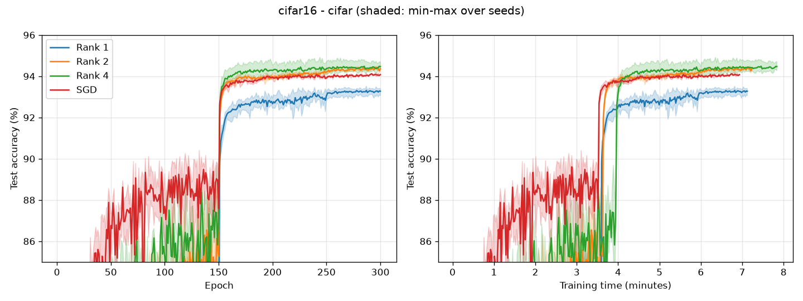
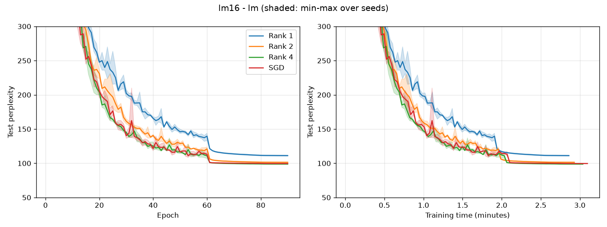

# PowerSGD paper reproduction: Table 3 on Perlmutter

16 GPUs (4 nodes x 4 A100, NCCL), paper hyperparameters, 3 seeds each, mean [min, max].
Generated with `./perlmutter/submit_paper.sh table3` and `paper-code/analyze_results.py`
(raw output in `summary.md`). Every individual run (seed, unrounded result, timings) is listed in
`per_run.md`. The raw per-run files (config, metric log, timers, Slurm log) are in
`powersgd_raw_runs.tgz`; to recompute the tables:

    mkdir -p raw && tar xzf powersgd_raw_runs.tgz -C raw && python ../../paper-code/analyze_results.py raw

All runs used 36.9 GPU-hours in total (24 jobs x 16 A100s, from `sacct`). Slurm's average GPU
utilization was 43-48% for ResNet18 and 95-96% for the LSTM, with 2.5-4.2 GB of GPU memory in use
(per-job values in `gpu_usage.txt`).

## Image classification: ResNet18 on CIFAR-10 (300 epochs)

| Algorithm | Test accuracy (ours) | Paper | MB/epoch (ours) | Paper | ms/batch (ours) | vs SGD | Paper vs SGD |
|---|---|---|---|---|---|---|---|
| SGD | 94.1% [94.1, 94.1] | 94.3% | 1073 | 1023 | 26.2 | +0% | +0% |
| Rank 1 | 93.3% [93.1, 93.4] | 93.6% | 4 | 4 | 28.3 | +8% | -26% |
| Rank 2 | 94.4% [94.3, 94.4] | 94.4% | 8 | 8 | 29.6 | +13% | -23% |
| Rank 4 | 94.5% [94.3, 94.7] | 94.5% | 15 | 14 | 33.2 | +27% | -16% |

## Language modeling: 3-layer LSTM on WikiText-2 (90 epochs)

| Algorithm | Test perplexity (ours) | Paper | MB/epoch (ours) | Paper | ms/batch (ours) | vs SGD | Paper vs SGD |
|---|---|---|---|---|---|---|---|
| SGD | 99.6 [99.4, 99.9] | 91 | 7882 | 7730 | 28.8 | +0% | +0% |
| Rank 1 | 111.2 [110.5, 112.0] | 102 | 25 | 25 | 26.5 | -8% | -56% |
| Rank 2 | 101.4 [100.9, 102.1] | 93 | 39 | 38 | 27.1 | -6% | -53% |
| Rank 4 | 98.9 [98.3, 99.3] | 91 | 65 | 64 | 28.1 | -3% | -55% |

## Findings

1. **Accuracy reproduces.** On CIFAR-10, Rank 2 and Rank 4 match the paper exactly and equal or beat
   SGD; Rank 1 is 0.3 points below the paper. On WikiText-2, quality improves with rank and Rank 4
   matches SGD, as in the paper.
2. **Compression reproduces.** Data sent per epoch matches the paper for every method
   (243x for Rank 1 and 136x for Rank 2 on ResNet18; 310x for Rank 1 on the LSTM).
3. **LSTM perplexities are about 8-9 points higher than the paper for every method, SGD included.**
   Because the offset is the same for all methods, it most likely comes from the data pipeline rather
   than from PowerSGD. The original code tokenized with spaCy (removed here together with the legacy
   torchtext API), which gives a slightly different vocabulary (28,869 vs our 28,913 tokens) and
   token stream.
4. **The wall-clock speedups do not reproduce.** The paper ran on 16 Titan X GPUs connected by a
   10 Gbit/s network, where communication dominated. On Perlmutter (NVLink within a node, Slingshot
   between nodes) the full SGD gradient all-reduce takes only 6.4 ms of a 26 ms CIFAR step and 4.4 ms
   of a 29 ms LSTM step. PowerSGD's compression work (per-layer matrix multiplications and
   orthogonalization) costs more than the communication it saves on ResNet18 (+8% to +27% per batch)
   and saves only 3-8% on the larger LSTM, compared with 16-26% and 53-56% in the paper.
   Communication volume, not wall-clock speed, is the part of the result that transfers to a modern
   cluster; the `scaling` experiment (Gloo backend, 1-16 GPUs) tests the bandwidth-limited regime.
5. **A full run is fast:** 300 CIFAR-10 epochs take about 7-8 minutes and 90 LSTM epochs about
   3 minutes on 16 A100s, versus roughly 45 minutes and 0.5 hours in the paper's Figure 4.

Note: the "running-average model" perplexity in `summary.md` is not meaningful for the LSTM. The
original `LanguageModelingTask.test` evaluates `self._model` (in training mode, with dropout) instead
of the averaged copy.
